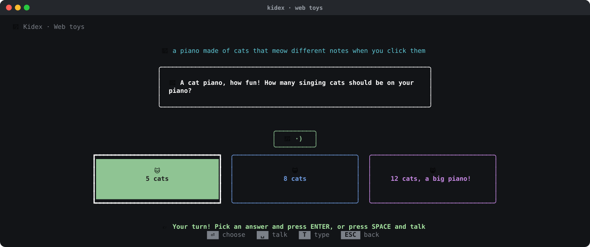
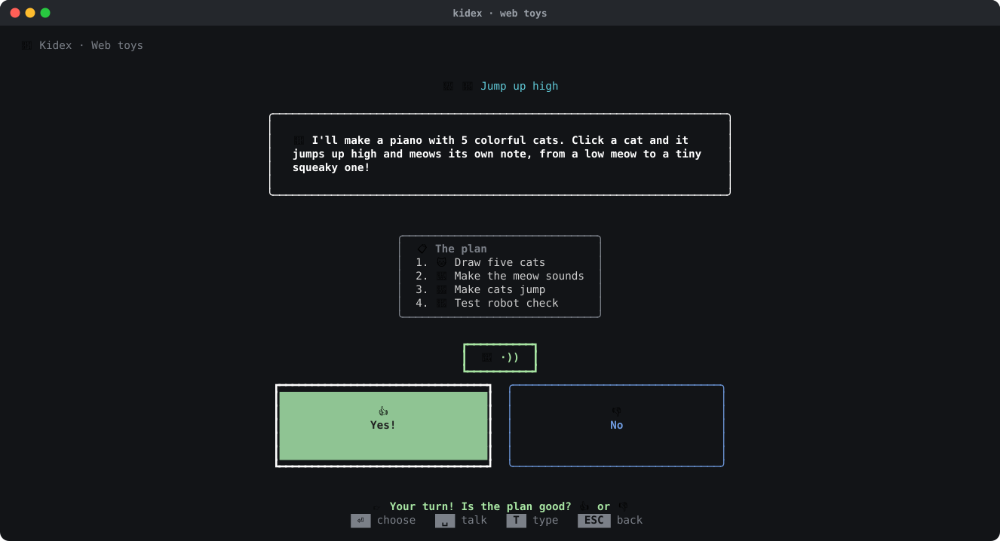
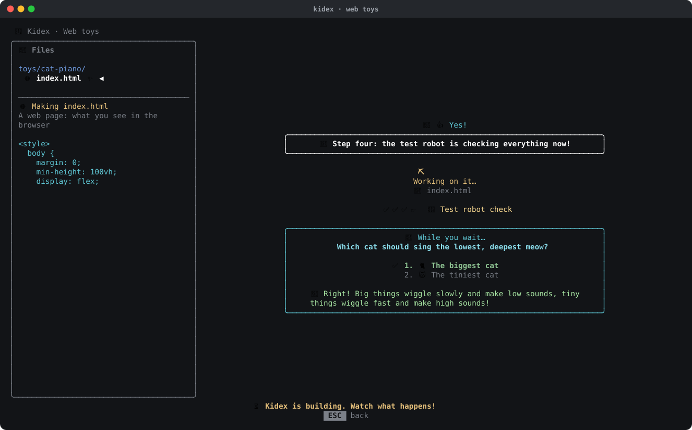
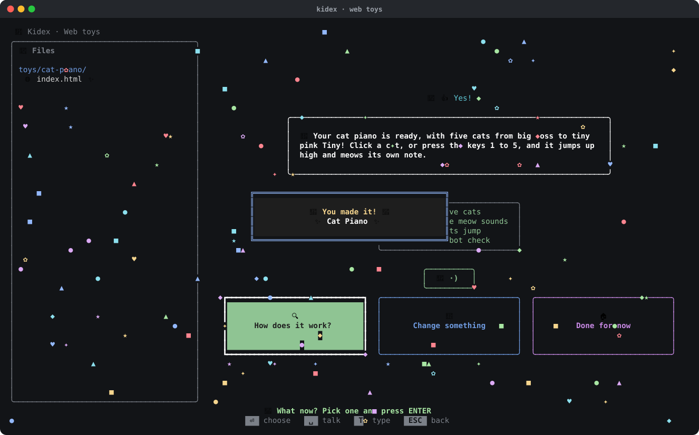
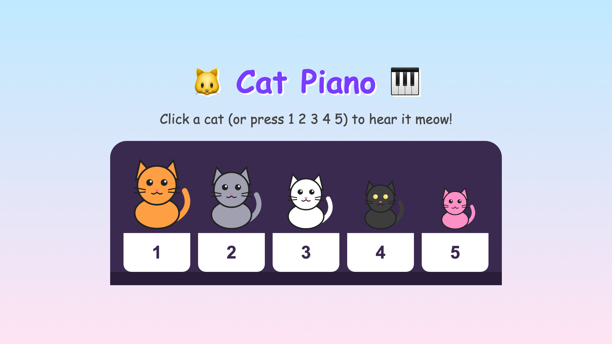
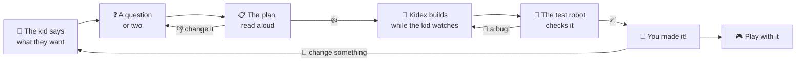
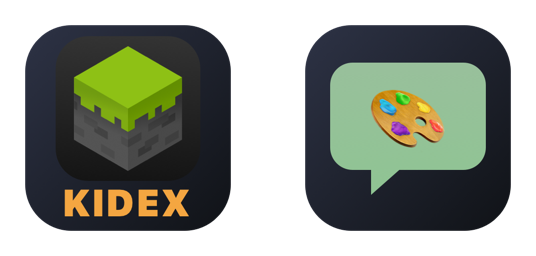

<p align="center">
  
</p>

<p align="center">
  
  
  
  
</p>

# 🧱 Kidex

**Your kid has the ideas. With Kidex, they turn them into real code just by talking.**

A magic wand that turns creepers into friends. A button that meows. A rifle that shoots faster. Kids know exactly what they want to make; what stops them is typing, syntax, and a blank editor. With Kidex they press space and say it. Kidex asks a question or two with big buttons, reads its plan out loud, and waits for their 👍. Then it builds the thing, tests it, and celebrates with them when it works.

<p align="center">
  
</p>

Under the hood it's Claude, the same coding agent grown-ups use, with a kid-sized screen in front of it and a guard that keeps the work safe.

## One sentence in, a toy out

Every picture here is from one real session in [`examples/web-toys`](examples/web-toys). The kid's whole wish was *"a piano made of cats that meow different notes when you click them"*.

<table>
  <tr>
    <td width="50%"></td>
    <td width="50%"></td>
  </tr>
  <tr>
    <td><b>🎤 A question or two.</b> "How many singing cats should be on the piano?" Big buttons, or just say the answer.</td>
    <td><b>📋 The plan, read out loud.</b> Four steps, in kid words. Nothing happens until the kid says 👍.</td>
  </tr>
  <tr>
    <td></td>
    <td></td>
  </tr>
  <tr>
    <td><b>🔨 Watch it being built.</b> The new file appears on the left with a peek at its code. The checklist ticks along. And a quiz: <i>which cat should sing the lowest meow?</i></td>
    <td><b>🎉 You made it!</b> Confetti, the toy's name in lights, and three ways to go on: how does it work, change something, or done.</td>
  </tr>
</table>

And here's what came out, [view code](examples/web-toys/toys/cat-piano/index.html) | [view in a browser](https://mthines.github.io/kidex/examples/web-toys/toys/cat-piano/index.html):

<p align="center">
  
</p>

## How a session goes



## Why parents like it

- **No typing needed.** Kids talk; Kidex listens. Kids who can type can press `T` and write instead. It speaks Danish and English, and follows whichever the kid speaks.
- **The kid is the boss.** Nothing is built until they've heard the plan and said yes. Want it blue instead? They just say so, and the plan changes.
- **They see what code is, without a wall of it.** While Kidex works, the files it makes ✨ and changes 🔨 grow as a little tree beside the chat. The file it's working on gets one sentence in kid words ("Code the game runs: this is where the magic happens") and a peek at a few lines.
- **Waiting is part of the fun.** The plan is a checklist that ticks off ✅ 👉 ⬜ as it builds. Now and then Kidex asks a small quiz about what it's doing, and explains the answer.
- **Bugs are puzzles, not failures.** Their work gets tested, with the project's own test. When the test robot finds a bug 🐛, the kid can guess why before Kidex fixes it 🔧. Errors say it's fine to try again; the scary details stay small, for grown-ups.
- **A party when it's done.** Confetti, a "You made it!" banner with the thing's name, and a sound. Then: 🔍 how does it work?, 🔧 change something, or 🏠 done.
- **Real projects, not a toy box.** Kidex works in your actual project: the one you already build with Claude Code. It was made for a family Minecraft server, where kids make their own mods and then play them on the server with everyone else: see [mthines/minecraft-mods](https://github.com/mthines/minecraft-mods), whose mods the kids made with Kidex. To start smaller, `examples/web-toys` lets them make little browser toys.

## Safe to hand over

Kidex lets kids drive a coding agent, so it checks every single step Claude takes, whatever the project's own settings allow:

- Nothing changes until the kid says 👍.
- Claude stays inside the project folder, away from passwords, keys, and anything you list.
- It only runs the commands you allow. It never commits, pushes, or rewrites git history, and it can't browse the web or download things itself.
- Each session has a spending limit (`budgetUsd`, $3 by default).
- The kid's voice stays on the Mac: speech-to-text and the voice both run locally, and Claude only gets the words, as text.

The details are under [Safety](#safety) below.

## What you need

- A Mac, and a Claude Code login (or an `ANTHROPIC_API_KEY`).
- A project with a `kidex.json` that says which buttons kids see, how their work gets tested, and which commands are OK. Or start with `examples/web-toys`.
- A few minutes for setup, below. Then sit next to them for the first one: it's more fun together.

## Setup (macOS)

```bash
brew install ffmpeg whisper-cpp
npm install
node bin/kidex.mjs setup     # downloads the speech model (~470 MB) and the Danish voice to ~/.kidex
node bin/kidex.mjs doctor    # checks the mic, speech, and voices
```

Kidex runs Claude through the [Claude Agent SDK](https://code.claude.com/docs/en/agent-sdk), which uses your Claude Code login or `ANTHROPIC_API_KEY`.

Speech never leaves the machine: [whisper.cpp](https://github.com/ggml-org/whisper.cpp) turns talking into text, and Kidex talks back with a voice that runs on the Mac too.

Kidex's default voice is [Piper](https://github.com/OHF-Voice/piper1-gpl), a free, open-source voice engine, with its Danish voice `da_DK-talesyntese-medium`. `kidex setup` installs it; for more languages, add them (`en`, or any [Piper voice](https://huggingface.co/rhasspy/piper-voices) name):

```bash
node bin/kidex.mjs setup voice en
```

Setup puts Python, Piper, and the voices in `~/.kidex` and installs `espeak-ng` with Homebrew. (Piper's Mac package can't find its own pronunciation data, so Kidex asks `espeak-ng` for the pronunciation and gives that to the voice.) Without Piper, Kidex uses macOS `say` with the best voice installed: Premium, then Enhanced, then the ordinary one. Apple's better voices are downloaded in System Settings → Accessibility → Read & Speak → the ⓘ to the right of System voice; Danish has none. `kidex doctor` shows which voice each language gets.

The first time a kid talks, macOS asks whether the terminal may use the microphone.

## Use

```bash
node bin/kidex.mjs path/to/project
```

| Key | |
| --- | --- |
| `SPACE` | start talking, `SPACE` again when done |
| `1`–`4`, arrows, `ENTER` | pick a button |
| `Y` / `N` | yes or no to the plan |
| `T` | type instead of talking |
| `L` | language: 🇩🇰 Dansk → 🇬🇧 English → 🌍 Auto (remembered on this computer, in `~/.kidex/settings.json`) |
| `TAB` | from the buttons to a `panel` program; `ESC` (when the program has no menu open to close) goes back. Away from the start screen the program keeps running on the right, in a narrower terminal it lays itself out for (the files panel goes on the left), and `TAB` opens it big again |
| `ESC` | back to the start |
| `Q` | quit (on the start screen) |

To try it without a project, use `examples/web-toys`: kids make small browser toys there.

### One click from the Dock

Kids shouldn't need a terminal to start Kidex. `kidex app` makes a Mac app for a project and puts it on the Dock and the Desktop: a click opens a terminal and starts Kidex there. Make one per project; each gets its own name and icon, and its name ends in "(Kidex)", so it's never mixed up with the game itself.

<p align="center">
  
</p>

```bash
# The game's own icon with KIDEX under it (left)
node bin/kidex.mjs app path/to/minecraft-mods --name Minecraft --icon-app "Minecraft Bedrock Launcher"
# A speech bubble with an emoji (right)
node bin/kidex.mjs app examples/web-toys --name "Web toys" --icon 🎨
```

| Flag | |
| --- | --- |
| `--name` | the app's name, shown as `<name> (Kidex)` (default: `name` in `kidex.json`, or the folder's name) |
| `--icon-app` | use another app's icon, like the game the project is for, with KIDEX under it: its name in `/Applications` or its path |
| `--icon` | without `--icon-app`: a letter or an emoji in the speech bubble (default: the name's first letter) |
| `--color` | the speech bubble's color, or KIDEX's with `--icon-app` (default: one picked from the name; orange) |
| `--command` | what to run in the folder instead of `kidex .`, like `"mc kidex"` |
| `--terminal` | `kitty`, `iTerm`, or `Terminal` (default: the first one installed, in that order) |
| `--no-dock`, `--no-desktop` | leave it off the Dock or the Desktop |

The app goes in `~/Applications`. Making it again with the same name replaces it in place, and the Dock and Desktop pick up the new icon. When Kidex quits, the terminal window closes; if Kidex fails, the window stays open to show why. Drawing the icon needs the Xcode Command Line Tools (`xcode-select --install`). The terminal the app opens is the one macOS asks about the microphone.

## Hook up a project

Put a `kidex.json` in the project's folder. For a whole project set up this way, with a `./mc kidex` that installs Kidex the first time, see [minecraft-mods](https://github.com/mthines/minecraft-mods) and its [`kidex.json`](https://github.com/mthines/minecraft-mods/blob/main/kidex.json):

```jsonc
{
  "name": "Our Minecraft mods",
  "language": "auto",                // "da", "en", or "auto" (follow the kid)
  "instructions": "Mods live in addons/. ...",   // added to Claude's prompt
  "check": "./mc test {mod}",        // Claude must get this passing before "done"
  "allow": ["npm run new", "./mc test", "./mc kit"],   // commands Claude may run after the 👍
  "deny": ["./mc restart", "server/data/"],            // commands or folders, never
  "budgetUsd": 3,                    // per session
  "model": "claude-opus-5-5",
  "effort": "medium",
  "voices": { "da": "piper:da_DK-talesyntese-medium", "en": "Samantha" },  // optional: a Piper voice or a macOS voice per language
  "git": { "branch": "kidex/{date}", "commit": true },  // optional: work on a branch, commit at the end
  "explain": { "kit.json": { "en": "What you get to try the mod", "da": "Det du får, når du prøver modet" } },
  "actions": [
    { "id": "new", "emoji": "✨", "label": { "en": "Make a mod", "da": "Lav et mod" }, "prompt": "Make a new mod." },
    { "id": "change", "emoji": "🔧", "label": "Change a mod", "pick": "addons/*", "prompt": "Change the mod in addons/{pick}." },
    { "id": "try", "emoji": "🎮", "label": "Try a mod", "pick": "addons/*", "run": "./mc kit {pick}" },
    { "id": "server", "emoji": "🖥️", "label": "Start the server", "panel": "./mc dev" }
  ]
}
```

- `explain` (optional) says in kid words what a project's own files are, for the files panel: keys are file names (`"kit.json"`) or folders (`"textures/"`), values a string or `{en, da}`. Without it, files are explained by type (code, settings, picture, test…).
- `pick` first shows the folders matching `dir/*` as buttons, and `{pick}` is replaced by the chosen one.
- `run` runs a plain command without Claude, e.g. to open or play something.
- `panel` runs a program that keeps going, like a dev server with its own full-screen view, in a terminal of its own. It fills the start screen, and the buttons move to a column on the left. Every key goes to the program, except `ESC` when the program has no menu open to close: that goes back to the buttons (`TAB` or the button returns). If the program quits, the button starts it again; it stops when Kidex quits.

Without a `kidex.json`, Kidex shows three general buttons and Claude may only look, not run anything.

## Safety

Kids drive an agent that can change files, so Kidex checks every tool call itself, in a `PreToolUse` hook that applies even when the project's own Claude settings allow more ([`src/guard.mjs`](src/guard.mjs)):

- **Nothing changes before the 👍.** Until the kid approves the plan, Claude can only read files and run look-only commands (`ls`, `cat`, `git status`, …).
- **Only the project.** Reading and writing stay inside the project folder, away from `.git/`, `.env`, `.claude/`, keys, and anything in `deny`.
- **Only listed commands.** After the 👍, Claude may run the `allow` prefixes and look-only commands. Every part of `a && b | c` must be allowed, and `$(…)`, backticks, and `>` redirects are refused.
- **Never:** `git push`/`commit`/`reset`/`checkout`, `sudo`, `curl`, `ssh`, `docker`, `kill`, web search and web fetch, whatever `allow` says.
- **A budget.** Each session stops at `budgetUsd`.

That keeps a kid from wrecking things by accident. It is not a sandbox against someone determined: an allowed command like `npm run x` runs whatever that script does. Only allow commands you trust.

## Without a screen

`kidex run` plays a session with no screen. It answers each question with the first choice and says yes to the plan. Handy for checking that a project's `kidex.json` and `CLAUDE.md` work:

```bash
node bin/kidex.mjs run examples/web-toys --say "a button that makes a cat sound" --action new
```

It prints one JSON event per line and exits 0 if Claude finished with `all_done`.

## How it works

| File | |
| --- | --- |
| `src/ui.mjs` | the screen ([Ink](https://github.com/vadimdemedes/ink)) |
| `src/session.mjs` | one conversation: Claude Agent SDK `query()` with Kidex's own tools (`ask_kid`, `show_plan` with its steps, `tell_kid` with the step and bug/fixed moments, `quiz_kid`, `draw_picture`, `all_done`). `draw_picture` writes pixel art to a PNG, so Claude never needs to run a script to make a picture. |
| `src/guard.mjs` | what Claude may do |
| `src/voice.mjs` | ffmpeg + whisper.cpp in, `say` out |
| `src/pictures.mjs` | draws the PNGs Claude made, right in the terminal |
| `src/panel.mjs` | runs a `panel` button's program in a pseudo-terminal ([node-pty](https://github.com/microsoft/node-pty)) and draws its screen ([xterm.js](https://github.com/xtermjs/xterm.js) headless) |
| `src/prompt.mjs` | how Claude should talk to kids |
| `src/launcher.mjs` | `kidex app`: builds the Mac app (AppleScript via `osacompile`), draws its icon (AppKit, via `swift`), and puts it on the Dock and the Desktop |
